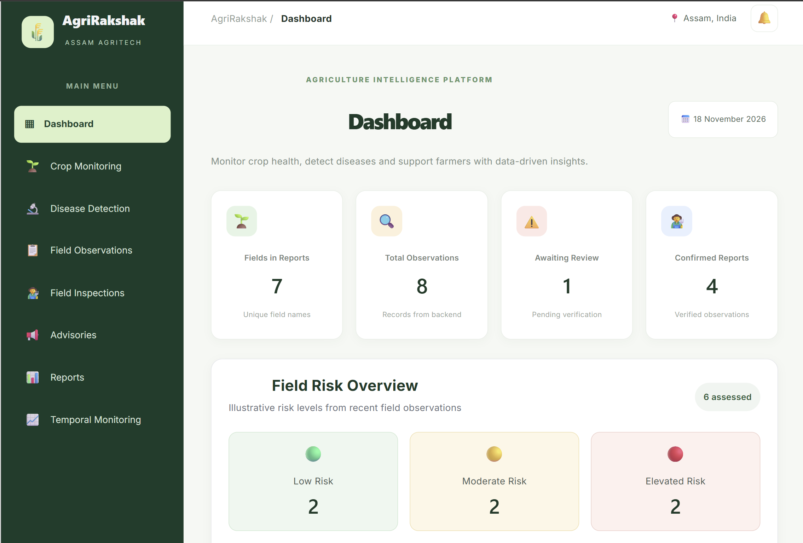
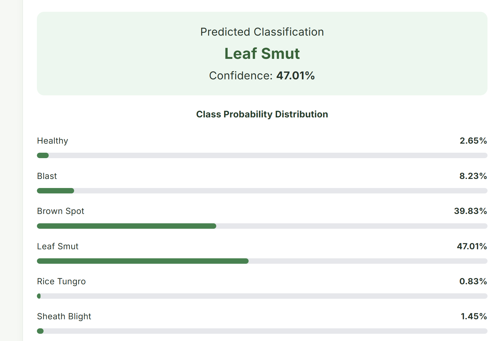
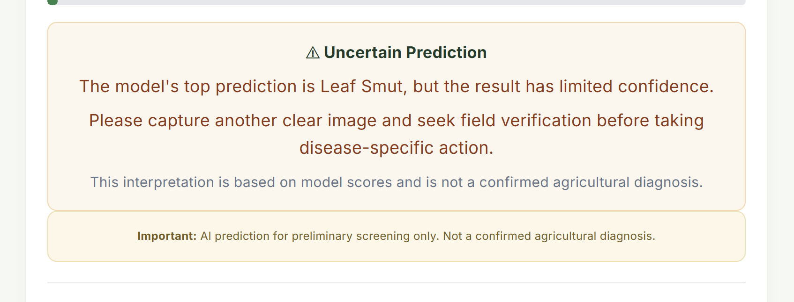
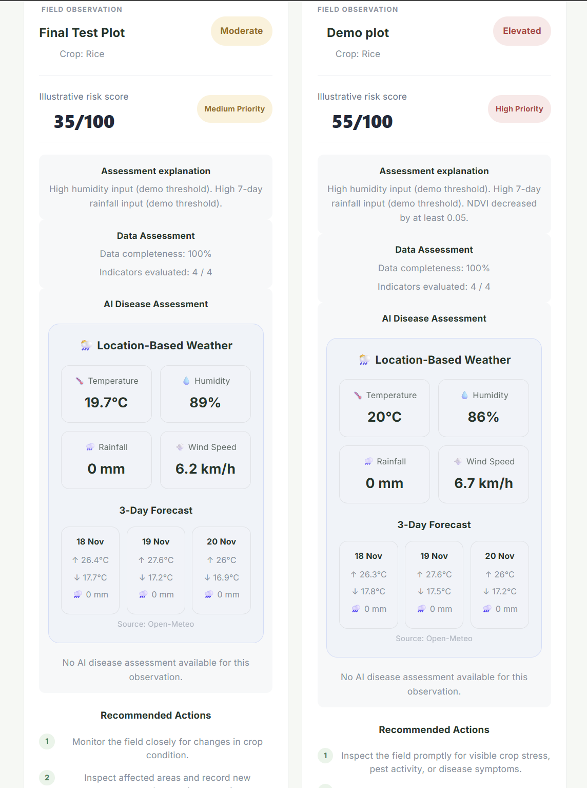
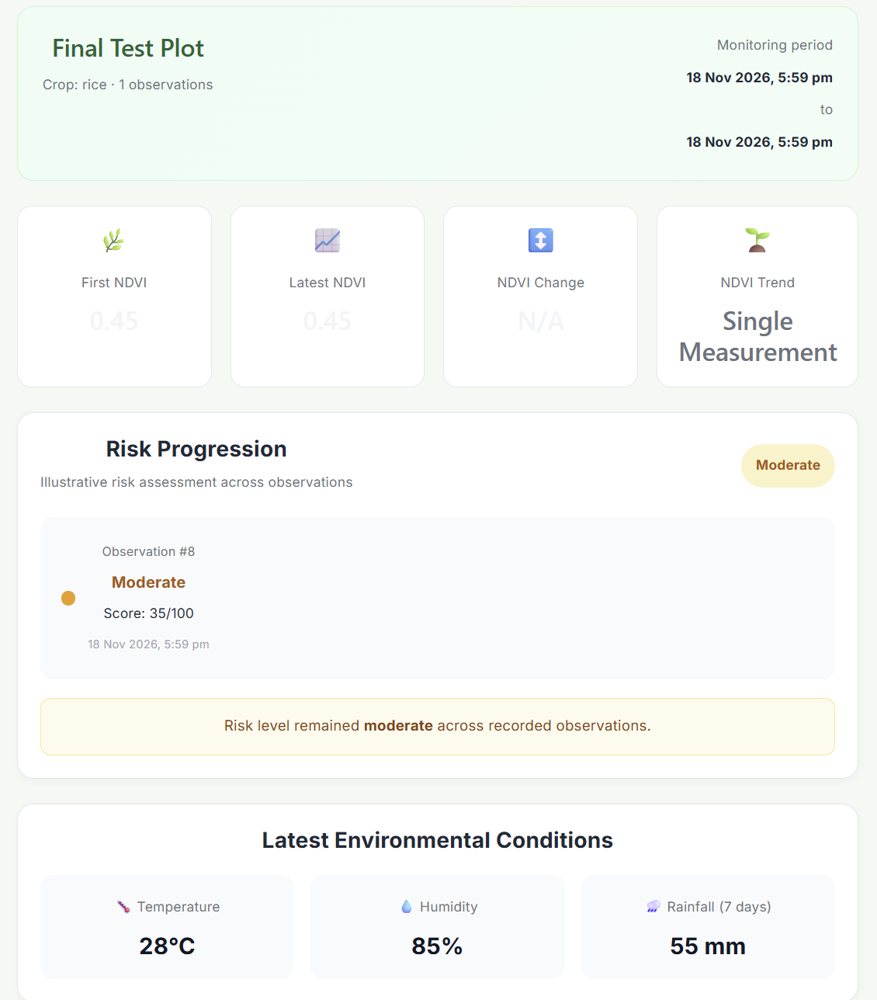
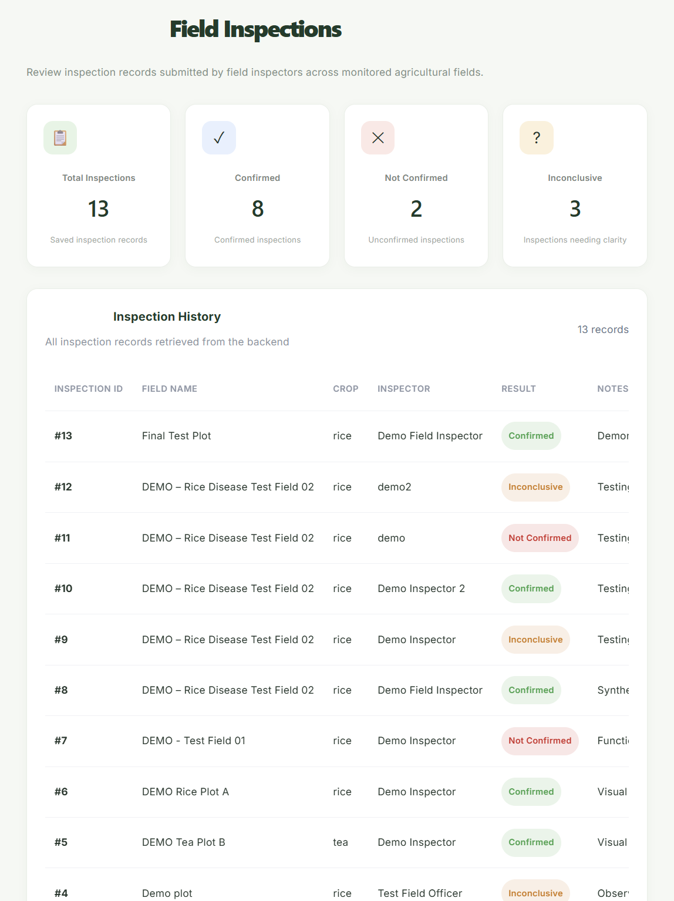
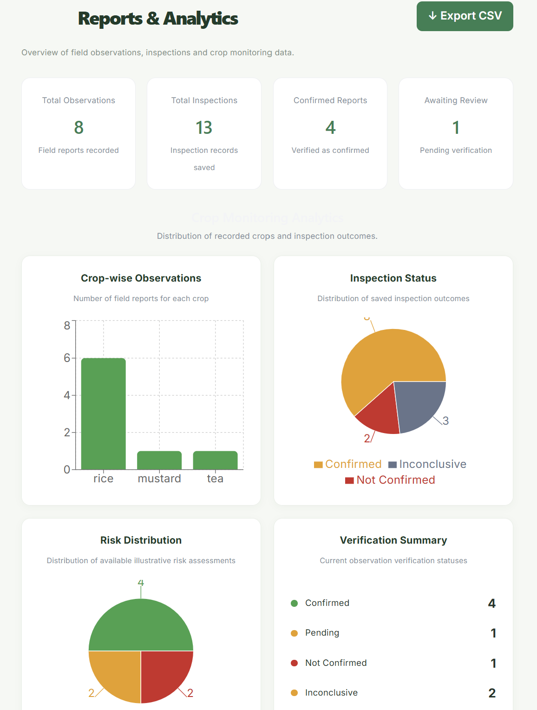
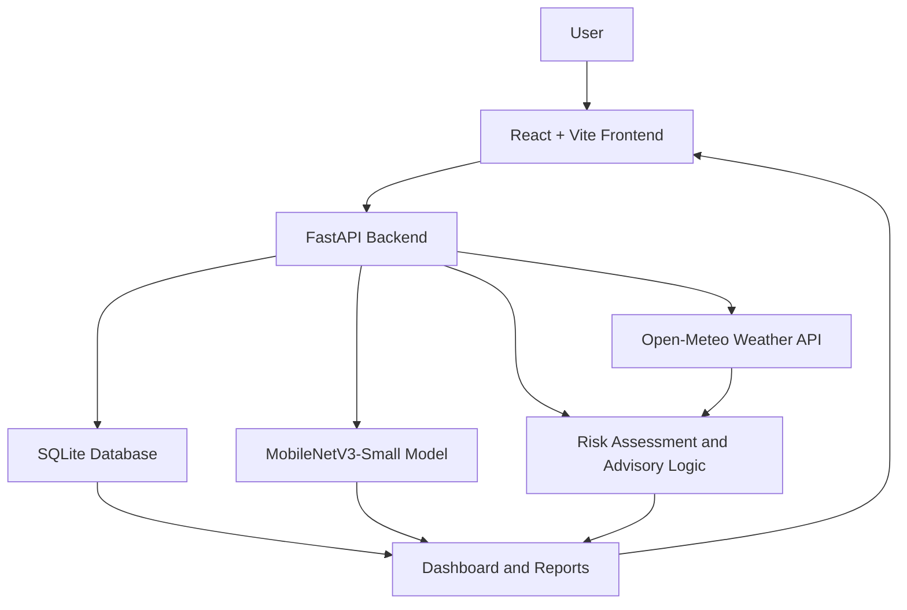

# 🌾 AgriRakshak Assam

## AI-Assisted Rice Crop Monitoring, Disease Screening & Field Advisory Platform

**An academic smart-agriculture prototype combining Machine Learning, digital field observations and weather intelligence to support preliminary rice crop-health monitoring and decision-making.**

<p align="center">
  
  
  
</p>

<p align="center">
  
  
  
  
</p>

---

## 📌 1. Project Overview

AgriRakshak Assam is an AI-assisted agricultural monitoring platform developed to explore how machine learning, weather information and digital field observations can support rice crop monitoring.

The platform integrates disease screening, field-level observations, weather information, preliminary advisories and monitoring tools into a unified web application.

### Project Objectives

- Develop an AI-based rice leaf disease screening system.
- Build a digital platform for recording agricultural field observations.
- Integrate weather information and short-term forecasts.
- Generate preliminary weather-aware field advisories.
- Support field inspections, verification and temporal monitoring.
- Provide consolidated reports and monitoring information.

> **Project Status:** Phase 1 — Working Prototype

---

## 🚀 2. Key Features

### 2.1 AI-Based Rice Disease Detection

- Upload rice leaf images for classification.
- Uses a MobileNetV3-Small deep-learning model.
- Supports six health and disease categories.
- Displays prediction confidence information.
- Provides warnings when predictions are uncertain.

### 2.2 Crop and Field Monitoring

- Create and manage field observations.
- Record crop information and field coordinates.
- View field records and associated measurements.
- Track observations over time.

### 2.3 Field Inspection and Verification

- Maintain field inspection records.
- Support verification of recorded field information.
- Organise inspection-related monitoring activities.

### 2.4 Weather Integration

- Retrieves current weather conditions.
- Provides a three-day weather forecast.
- Uses the Open-Meteo API for weather information.

### 2.5 Weather-Aware Field Advisories

- Combines weather information with field context.
- Generates preliminary field-specific advisories.
- Helps review potential crop-monitoring concerns.

### 2.6 Temporal Monitoring

- Tracks changes in field observations.
- Displays vegetation-related indicators.
- Supports monitoring of risk assessments over time.

### 2.7 Dashboard and Reports

- Provides a consolidated monitoring dashboard.
- Displays important field and crop information.
- Supports report viewing and CSV exports.

---

## 🖥️ 3. Application Screenshots

The following screenshots demonstrate the main modules of AgriRakshak Assam.

### 3.1 Dashboard



### 3.2 AI Disease Detection — Prediction Result



### 3.3 Uncertain Prediction Warning



### 3.4 Weather-Based Advisories



### 3.5 Temporal Monitoring



### 3.6 Field Inspections



### 3.7 Reports and Analytics



---

## 🧠 4. Machine Learning Model

The project uses **MobileNetV3-Small**, a lightweight Convolutional Neural Network (CNN), with transfer learning for rice leaf image classification.

### 4.1 Model Configuration

| Parameter | Details |
|---|---|
| Architecture | MobileNetV3-Small |
| Framework | PyTorch |
| Input Image Size | 224 × 224 pixels |
| Number of Classes | 6 |
| Training Environment | Google Colab |
| Training GPU | NVIDIA Tesla T4 |
| Learning Approach | Transfer Learning |

### 4.2 Classification Categories

| Class ID | Category |
|---:|---|
| 0 | Healthy |
| 1 | Blast |
| 2 | Brown Spot |
| 3 | Leaf Smut |
| 4 | Rice Tungro |
| 5 | Sheath Blight |

### 4.3 Dataset Information

**Dataset:** RiceLeafDiseaseBD — Version 3

| Dataset Split | Number of Images |
|---|---:|
| Original Audited Dataset | 9,769 |
| Cleaned Candidate Unique Images | 9,722 |
| Training Set | 6,805 |
| Validation Set | 1,458 |
| Testing Set | 1,459 |
| **Total Cleaned Images** | **9,722** |

### 4.4 Baseline Model Performance

| Evaluation Metric | Result |
|---|---:|
| Baseline Test Accuracy | 71.69% |

**Note:** The reported 71.69% accuracy belongs to the baseline experiment. It should not be interpreted as the performance of every subsequent model checkpoint.

---

## 🏗️ 5. System Architecture

The application connects the frontend, backend, database, machine-learning model and external weather service.

### 5.1 Architecture Workflow



### 5.2 Main Components

- **Frontend:** Web interface and user interaction.
- **Backend:** API requests and application logic.
- **Database:** Application records using SQLite.
- **ML Model:** Rice leaf image classification.
- **Weather Service:** Current weather and forecast information.
- **Advisory Logic:** Preliminary advisories based on available weather and field information.

---

## ⚙️ 6. Technology Stack

| Component | Technology |
|---|---|
| Frontend | React, Vite |
| Backend | Python, FastAPI |
| Database | SQLite |
| Machine Learning | PyTorch, Torchvision |
| Deep Learning Model | MobileNetV3-Small |
| Weather Data | Open-Meteo API |
| Development Environment | VS Code |
| Model Training | Google Colab |
| Version Control | Git, GitHub |

---

## 📂 7. Project Structure

```text
AgriRakshak-Assam/
│
├── backend/
│   ├── app/
│   └── models/
│
├── dashboard/
│
├── docs/
│   └── screenshots/
│       ├── dashboard.png
│       ├── disease-detection-result.png
│       ├── disease-detection-warning.png
│       ├── advisories-weather.png
│       ├── temporal-monitoring.png
│       ├── field-inspections.png
│       └── reports-analytics.png
│
├── frontend/
│   ├── public/
│   └── src/
│
├── mobile/
├── scripts/
│
├── .gitignore
├── package.json
├── package-lock.json
├── requirements.txt
└── README.md
```

---

## 💻 8. Installation and Local Setup

Follow these instructions to run AgriRakshak Assam locally.

### 8.1 Prerequisites

Install the following:

- Python 3.10 or later
- Node.js and npm
- Git

### 8.2 Clone the Repository

```bash
git clone https://github.com/Shajeb-ECE/AgriRakshak-Assam.git

cd AgriRakshak-Assam
```

### 8.3 Create a Python Virtual Environment

**Windows PowerShell:**

```powershell
py -3.11 -m venv .venv

.\.venv\Scripts\Activate.ps1
```

Upgrade pip and install dependencies:

```powershell
python -m pip install --upgrade pip

pip install -r requirements.txt
```

### 8.4 Start the Backend

From the project root directory:

```bash
uvicorn backend.app.main:app --reload --host 127.0.0.1 --port 8001
```

**Backend URL:**

http://127.0.0.1:8001

**API Documentation:**

http://127.0.0.1:8001/docs

### 8.5 Start the Frontend

Open a second terminal:

```bash
cd frontend

npm install

npm run dev
```

Open the local URL displayed by Vite, usually:

http://localhost:5173

> **Important:** Keep both the backend and frontend terminals running while using the application.

---

## ⚠️ 9. Limitations and Responsible Use

AgriRakshak Assam is an academic prototype. Its current limitations must be considered when interpreting results.

- **Preliminary Predictions:** AI outputs are screening results, not confirmed agricultural diagnoses.
- **Dataset Dependency:** Model performance depends on image quality and dataset diversity.
- **Demo Records:** Synthetic or demonstration records must not be interpreted as actual farm observations.
- **Weather Data:** Weather information comes from an external service and is not directly measured by field sensors.
- **Illustrative Risk Assessment:** Risk scores and vegetation trend indicators are illustrative and are not scientifically validated outbreak predictions.
- **Expert Verification:** Agricultural experts should verify findings before crop-treatment decisions.
- **Treatment Decisions:** The application should not be used to prescribe pesticides or other chemical treatments.

---

## 🔮 10. Future Scope

### 10.1 Machine Learning Improvements

- Improve model accuracy and generalisation.
- Collect more diverse, expert-verified local rice leaf images.
- Evaluate model performance on real-world field images.

### 10.2 Smart Agriculture Integration

- Explore satellite-based crop monitoring.
- Integrate field-level IoT sensors.
- Develop a mobile application for field use.

### 10.3 Platform Improvements

- Add multilingual support for local farmers.
- Improve monitoring and reporting capabilities.
- Validate risk assessment and advisory logic with agricultural experts.

---

## 👨‍💻 11. Project Information

| Detail | Information |
|---|---|
| Project Name | AgriRakshak Assam — Phase 1 |
| Developer | Shajeb Ansari |
| Academic Programme | B.Tech ECE + MBA Dual Degree |
| Institution | Tezpur University, Assam |
| Project Domain | Machine Learning and Smart Agriculture |
| GitHub Repository | [AgriRakshak-Assam](https://github.com/Shajeb-ECE/AgriRakshak-Assam) |

---

<p align="center">

## 🌾 AgriRakshak Assam

**Bridging Machine Learning, Field Intelligence and Smart Agriculture.**

*An academic prototype exploring AI-assisted crop monitoring and agricultural decision support.*

</p>
